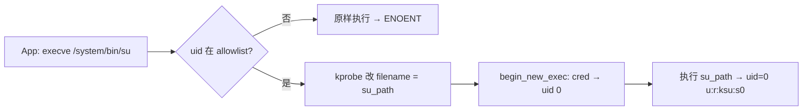

# 荣耀 Magic6 Pro（BVL-AN16）运行时 KernelSU + su 完整技术报告

> 目标读者：遇到「内核模块装上了、管理器也授权了，但 `su` 就是不能用」的人。
> 这份报告从原理讲到落地，包含可复制的命令、判据、失败模式与实测数据，
> 照着做能在同内核镜像的机器上复现，换机型时也知道该改哪里。
>
> 版本：2026-10-24 · 状态：**已打通并真机验证**

---

## 摘要

在 BL 未解锁、不改系统镜像、SELinux 保持 Enforcing 的前提下，通过 CVE-2026-43499 拿到临时内核读写，
把厂商源码树自编的 KernelSU 系 `.ko` 装进内核，再让管理器授权 App —— 最终在授权 App 内
`su -c id` 输出 `uid=0(root) context=u:r:ksu:s0`。

**核心结论：`su` 能不能用由四个互相独立的条件共同决定**，任何一个不成立，报错现象都极其相似：

| # | 条件 | 一句话 |
|---|---|---|
| 1 | ko 进入内核 | `/proc/modules` 里有 `kernelsu … Live` |
| 2 | `su_path` 进了 insmod 参数 | `KSU_PARAMS` 里能看见 |
| 3 | 该路径在 App 域可执行 | 标签必须是 `apk_data_file` 一类，不能是 `device` |
| 4 | 调用者被管理器授权 | allowlist 里有它的 uid |

**最大的坑不是技术，是测量方法**：用 `adb shell`（uid 2000）测 `su` 永远失败，
和「内核钩子坏掉」表现完全一样。详见 §7。

---

## 1. 环境与适用性

| 项 | 值 |
|---|---|
| 机型 | 荣耀 Magic6 Pro（`BVL-AN16`，device `HNBVL`） |
| 系统 | MagicOS 10.0.0.170 `C00E170R202P8` / Android 16 |
| 内核 | `6.1.157-android14-11-g7d3922fade43` |
| fingerprint | `HONOR/BVL-AN16/HNBVL:16/HONORBVL-AN16/10DLDLD170C00E170:user/release-keys` |
| SELinux | Enforcing（全程未设 permissive） |
| BL | **未解锁**，未刷 boot/vbmeta，未改系统镜像 |
| 提权面 | CVE-2026-43499（futex-PI 8 字节任意写 + pselect 栈载波 + KernelSnitch 泄 mm_struct） |

**适用性判断**：这套方案绑定的是**内核镜像**，不是机型。判据只有两条逐字比对：

```bash
uname -r     # 与 ko 的 vermagic 一致
getprop ro.build.fingerprint
```

一致 ⇒ 直接复用现成 ko；不一致 ⇒ 要重采 `kallsyms`、重编 ko、重采 CRC 表（见 §8）。

---

## 2. 为什么必须自编 ko

| 尝试 | 结果 |
|---|---|
| 现成 `kernelsu-os9-selx11.ko`（6.1.157） | 只有 syscall 表 hook，**没有 kprobe 版 sucompat** ⇒ 授权了也拿不到 su |
| kit/CGA 那份带 sucompat 的 ko | vermagic 是 6.1.128，不匹配 |
| 用 ACK 自编 6.1.157 | panic：`struct module` 1024 B ≠ 厂商 1088 B |
| **用荣耀开源厂商树编** | ✅ ABI 天然一致，能编出带 kprobe sucompat 的 ko |

厂商树来源：荣耀开源中心 → 手机 → 第 3 页 → `Bvlgari_MagicOS10.0_Code_Opensource`（537 MB）。
注意包里 `kernel/Makefile` 是 **6.1.128**，设备跑 **6.1.157**，构建时必须：

```
sublevel=157
localversion=-android14-11-g7d3922fade43
```

---

## 3. 原理：su 到底是怎么来的

### 3.1 三条独立链路

```
链路 A  App 自身 root   ：exploit 直接改 current->cred（uid 2000→0）→ 只有本进程有效
链路 B  管理器授权      ：管理器 ↔ 内核 supercall，维护 allowlist，决定「谁有资格」
链路 C  sucompat        ：App execve("/system/bin/su") → 内核把文件名换成 su_path → 执行
```

**A 和 C 无关**。App 自己能 root，不代表 `su` 能用 —— 这正是最容易误判的地方。

### 3.2 sucompat 的两个钩子

| 钩子点 | 干什么 |
|---|---|
| kprobe `do_execveat_common` | 目标名是 `/system/bin/su` 且 uid 在 allowlist ⇒ 把 `bprm->filename` 改成 `su_path` |
| `begin_new_exec` / `security_bprm_committing_creds` | 改 `bprm->cred`：uid/gid/caps 归零，SELinux SID 写成 kernel 域 |



### 3.3 为什么 su 落点这么难选

| 候选 | 标签 | 结论 |
|---|---|---|
| `/system/bin/su` | `system_file` | 荣耀原厂**不存在**，靠内核重定向才有 |
| `/dev/su`（KernelSU 默认） | 需 `u:object_r:ksu_file:s0` | ✗ 该类型是 **ko 装载后**才注入 policy；装载前 `chcon` 必失败（实测停在 `device:s0`），装载后 loader 已失权 |
| `<app lib>/libksu_su.so` | 自动 `apk_data_file` | ✅ App 域按类型级规则可 exec，无需 chcon |

### 3.4 为什么装载后 loader 会失去 root

loader 的 root 来自 exploit 塞进 cred 的**伪造 SID**（`u:r:kernel:s0`）。装载 ko 后：

1. ko 注入自己的 policy / selinux_hide ⇒ 伪造 SID 失效，`open/exec/access` 全拒；
2. `su_cred=2` 的 task_work 在任务切换时回滚 cred。

**这不是 bug，是设计。** 结论：装载后要做的事，一律前置。

---

## 4. 实施步骤

### 4.1 准备载荷（App 侧）

App 必须把两个只有它才知道的路径写给 loader —— loader 自己查不到：

```kotlin
val lib = context.applicationInfo.nativeLibraryDir          // /data/app/…/lib/arm64
val apk = context.packageCodePath
exec("printf '%s' '$lib' > $RD/SELF_LIB")
exec("printf '%s' '$apk' > $RD/SELF_APK")
```

原因：loader 运行在 `u:r:kernel:s0`，那里 `pm path` / `cmd package` / `dumpsys`
**全部返回空**（`app_process` 被 exec 拒绝）。

载荷清单 23 个文件，关键几项：

| 文件 | 作用 |
|---|---|
| `load_ko` | 真正的 insmod（带符号解析，2,142,392 B） |
| `ko_patch2` | 把 UND 符号改写成静态地址（SHN_ABS） |
| `next_sym_addr_uapi5.txt` | 271 条符号静态地址 |
| `dc_ksu_run.sh` / `ksu_loader.sh` / `post_root.sh` | 提权主链 |
| `kernelsu_*.ko` × 7 | 不同管理器对应的模块 |

### 4.2 装载前：把 su 落点准备好

```sh
SELF_LIB=$(cat "$RD/SELF_LIB")
SU_PATH_RUNTIME="$SELF_LIB/libksu_su.so"
cp -f "$RD/ksud_resukisu" "$SU_PATH_RUNTIME"
chmod 755 "$SU_PATH_RUNTIME"
# 标签自动是 apk_data_file，不需要 chcon
```

同时把也要在装载后做的事一起做完：铺 `/data/adb/ksud`、写 allowlist、准备参数。

### 4.3 装载

```sh
$RD/load_ko "$RD/.run_kernelsu.ko" \
    su_cred=2 su_check=1 su_path="$SU_PATH_RUNTIME" \
    mgr_pkgs="me.yuki.fina" grant_apps=Y
```

判定（装载后已经读不到 `/proc/modules`，改用退出码兜底）：

```sh
if [ "$MOD" = "0" ] && [ "$LOAD_RC" = "0" ]; then
    echo "kernelsu LIVE"
fi
```

外部复核（adb shell 可读）：

```bash
adb shell grep kernelsu /proc/modules
# kernelsu 339968 1 - Live 0xffffffdaf2744000 (E)
```

### 4.4 授权

管理器（FinaSU `me.yuki.fina` / SukiSU `com.sukisu.ultra`）里把目标 App 打开授权。
授权名单里的 uid 就是 sucompat 判定用的那个。

### 4.5 验证（**必须 App 域**）

```sh
# aShell 或任何已授权 App
su -c id
# uid=0(root) gid=0(root) groups=0(root) context=u:r:ksu:s0
```

---

## 5. 失败模式与判据表

| 症状 | 在哪看 | 原因 | 处理 |
|---|---|---|---|
| `load_ko_exit=3` | `loadko_result.log` | 有符号没解析 | 补 `next_sym_addr` 清单 |
| `load_ko_exit=127` | 同上 | 二进制缺失 | 补 `load_ko` 等载荷 |
| `load_ko_exit=126` | 同上 | 权限/标签 | `chmod 755` + 确认 `apk_data_file` |
| `19 symbols still UND` | `ko_patch2` 输出 | 清单漏项 | 补清单；`ko_patch2` 是全有或全无 |
| `disagrees about version of symbol` | dmesg | CRC 不匹配 | 用 `device_crc.json` 对齐源码/配置 |
| `/proc/modules` 无 kernelsu | adb | 没装上 | 回到上一行逐项查 |
| `KSU_PARAMS` 无 `su_path` | `ksu_load.log` | 阶段 2/3 没做成 | 检查 `SELF_LIB` 与 `su_path` 拼装 |
| `su` → `inaccessible or not found` | App 里 | ① 用了 adb shell（uid 2000）② 落点不可执行 ③ 未重定向 | 先换 App 域；再 `ls -lZ` 看标签 |
| `su` → `Permission denied` | App 里 | 落点标签是 `device:s0` 等 | 换到 `apk_data_file` |
| 授了权仍失败 | 管理器 | allowlist 是旧 boot 的 / `grant_apps=N` | 重启后重授权，或 insmod 带 `grant_apps=Y` |
| loader 报一堆 `Permission denied` | `dc_ksu.log` | 装载后正常失权 | 不用修，收尾前置 |
| `Segmentation fault` / `rc=139` | `dc_ksu.log` | 内核替进程 exec 时 oops（信号≠权限） | 换 ko 版本做 A/B；不影响已授权 App 用 su |

---

## 6. 实测数据（可对照）

### 6.1 已验收的 ko

| ko | 大小 | 源码 tag | uapi | 管理器 |
|---|---|---|---|---|
| `kernelsu_finasu.ko` | 7,489,752 B | FinaSU `v1.0.9` | 6 | `me.yuki.fina` |
| `kernelsu_sukisu.ko` | 7,465,008 B | SukiSU `v4.2.1-r1` | 6 | `com.sukisu.ultra` |
| `kernelsu_custom.ko` | 10.3 MB | BakaSU `main` | 5 | `com.bakasu.bakasu` |
| `kernelsu_ksu331.ko` | 6.1 MB | KernelSU `v3.3.1` | 5 | `me.weishu.kernelsu` |
| `kernelsu_next.ko` | 6.4 MB | KernelSU-Next `v3.4.2` | 5 | 伪装包名 |

### 6.2 装载成功时的日志特征

```
[ko_patch] slide=0x244b400000
sym file: 271 entries
OK: 239 symbols -> SHN_ABS
read .run_kernelsu_finasu.ko (7489752 bytes)
undefined symbols to resolve: 0
[+] module loaded OK!
load_ko_exit=0
/proc/modules → kernelsu 339968 1 - Live 0xffffffdaf2744000 (E)
```

### 6.3 成功的 su

```
$ su -c id
uid=0(root) gid=0(root) groups=0(root) context=u:r:ksu:s0
```

### 6.4 失败的 su（不是 bug 的那种）

```
$ adb shell su -c id
/system/bin/sh: su: inaccessible or not found
```

---

## 7. 三个最容易走错的判断

### 7.1 用 adb shell 测 su（代价最大）

`adb shell` 是 `uid=2000(shell)`，不在 allowlist ⇒ sucompat 按设计不重定向 ⇒ 永远 ENOENT。
`allow_shell=1` 只是 insmod 参数，不等于把 2000 写进持久授权名单。

**这个假阴性让本项目白写了三版 patch**，一度得出「uapi6 与厂商内核不兼容」的错误结论。

### 7.2 把 `rc=139` 当权限问题

`139 = 128 + 11 = SIGSEGV`。权限只会给 EACCES/EPERM，**绝不会给信号**。
出现信号说明内核替进程执行时崩了（钩子按编译期偏移踩错结构），性质完全不同。

### 7.3 以为「模块 Live」等于「su 可用」

Live 只证明内核里那段代码在跑。su 还需要 `su_path` 参数、可执行的落点、allowlist 三件事。

---

## 8. 换机型 / 换内核时的检查清单

1. `uname -r` 与 ko vermagic 逐字比对；不同就重编
2. 重采 `/proc/kallsyms`（约 42 万条），生成新的 `next_sym_addr*.txt`
3. 用新内核的 `Module.symvers` 生成 `config/device_crc.json`
4. 确认 `do_execveat_common` / `begin_new_exec` / `security_bprm_committing_creds` 存在
5. 重跑 exploit（dc profile、环境变量、`resize_pipe_slots`）
6. 装载后 `grep kernelsu /proc/modules` 复核
7. **在 App 域**测 `su -c id`

---

## 9. 术语

| 词 | 含义 |
|---|---|
| sucompat | KernelSU 的 su 兼容层：拦截 `execve` 把 `su` 重定向到真 su 二进制 |
| KSU_PARAMS | 传给 ko 的 insmod 参数串（`su_cred` / `su_path` / `mgr_pkgs` …） |
| SHN_ABS | 符号段索引，表示「地址已固定」，用于把 UND 符号改写成静态地址 |
| allowlist | 管理器维护的授权名单（uid/包名），sucompat 与 supercall 都看它 |
| `su_cred` | 授权策略档位；`2` = 通过 task_work 临时提权并在退出时回滚 |
| `apk_data_file` | App 私有数据目录的 SELinux 类型；App 域可 exec 其下文件 |

---

## 10. 相关文档

| 文件 | 内容 |
|---|---|
| `docs/su-playbook.md` | 操作手册（四条件 / 六步 / 排错表） |
| `docs/su-问题解决记录.md` | 复盘：四个排查阶段、误判在哪 |
| `docs/status_20261024.md` | 当前状态快照 |
| `docs/progress_20261024.md` | 当天逐条日志 |
| `docs/new-device-checklist.md` | 同型号同固件机器直用清单 |
